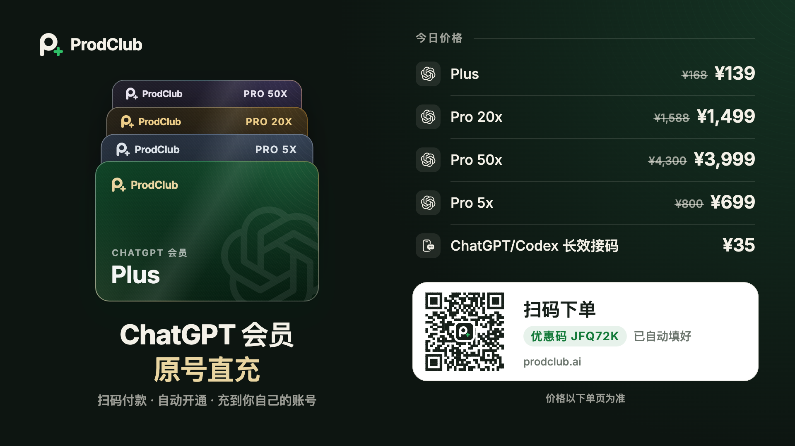
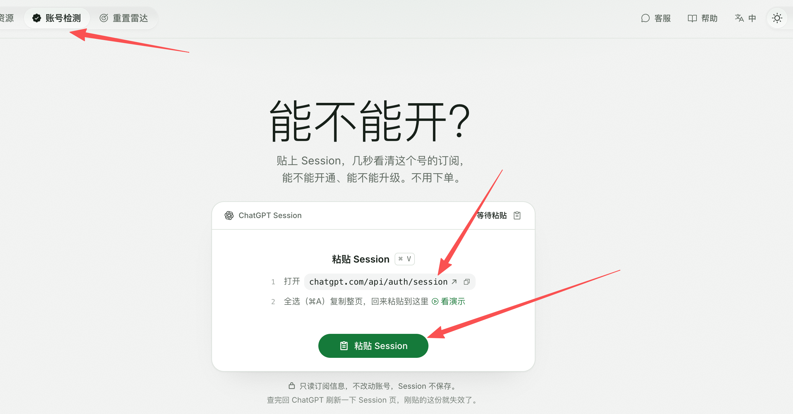
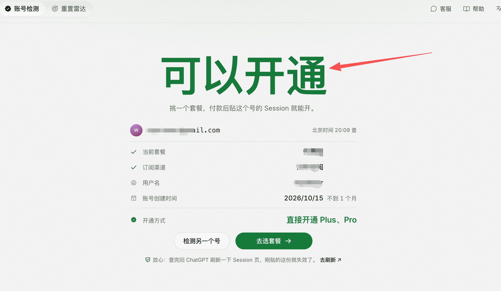
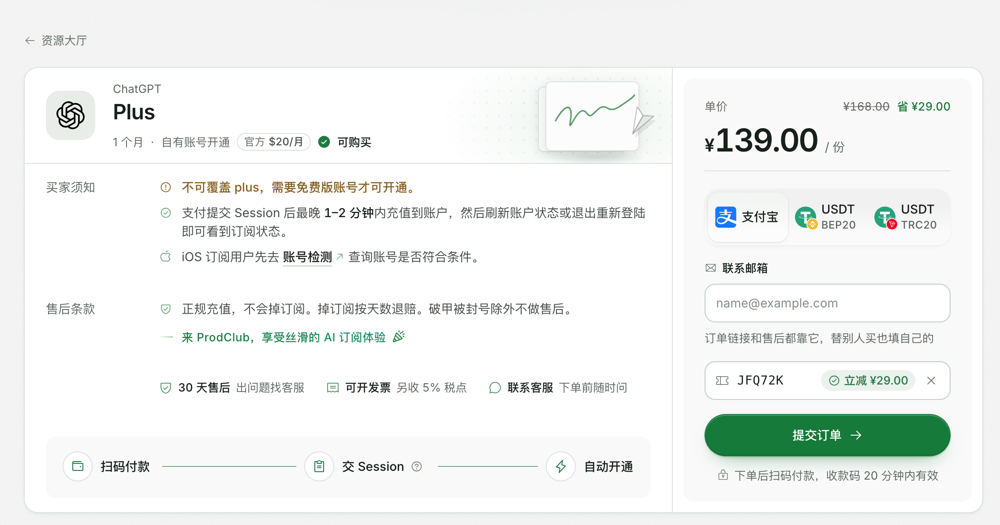

<div align="center">

# ChatGPT 代充 · ChatGPT Plus / Pro 充值订阅开通 — ProdClub

**支付宝 ChatGPT 代充 · 无需提供账号密码 · 充到你自己的账号 · 30 天售后**

ProdClub 提供 ChatGPT 充值、ChatGPT 订阅、ChatGPT 开通服务：ChatGPT Plus 代充与 ChatGPT Pro 代充均可支付宝付款，订阅周期 1 个月，另提供 GPT 代充、Codex 代充与 ChatGPT / Codex 接码咨询。

[](https://prodclub.ai/r/JFQ72K)
[](#-套餐与价格)
[](#-售后与退赔)

**👉 开通入口：https://prodclub.ai/r/JFQ72K**

</div>

<div align="center">

[](https://prodclub.ai/r/JFQ72K)

*扫码付款 · 自动开通 · 充到你自己的账号 — 点图也可直达开通页，优惠码 `JFQ72K` 已自动填好*

</div>

---

## 为什么选这个渠道？

开通 ChatGPT 订阅，国内用户最常卡在三件事：没有海外支付方式、怕买到不稳定的渠道、出了问题没人管。

ProdClub 把这三件事一次解决：

- **💳 支付宝直接支付** — 不需要海外信用卡，不需要折腾虚拟卡，用支付宝就能下单。
- **🔐 无需提供 GPT 账号密码** — 订阅充到你自己的账号，你不需要把账号密码交给任何人（开通方式见下文）。
- **🏦 正规资金，安全有保障** — 正规支付通道，资金流向清晰，可开**发票**，支持**公对公批量订单**。
- **🛡️ 30 天售后** — 正规充值，不会掉订阅；万一掉订阅，**按剩余天数退赔**，出问题找客服处理。
- **📊 稳定运营，真实战绩** — 已稳定完成 **上万次** 订阅开通，保持 **0 封号、0 售后纠纷** 记录。

---

## 套餐与价格

全部为人民币价格，支付宝支付，**订阅周期均为 1 个月**：

| 套餐 | 原价 | 现价 | 周期 | 适合谁 |
| --- | --- | --- | --- | --- |
| **ChatGPT Plus** | ~~¥168~~ | **¥139** | 1 个月 | 日常写作、编程、学习、办公，性价比首选 |
| **ChatGPT Pro 5X** | ~~¥800~~ | **¥699** | 1 个月 | 用量为 Plus 5 倍档位，适合高频重度使用 |
| **ChatGPT Pro 20X** | ~~¥1,588~~ | **¥1,499** | 1 个月 | 用量为 Plus 20 倍档位，适合专业高强度工作 |
| **ChatGPT Pro 50X** | ~~¥4,300~~ | **¥3,999** | 1 个月 | 用量为 Plus 50 倍档位，适合最高强度需求 |

> 每档的具体权益以 OpenAI 官方规则为准，价格确认清楚后再付款。

### Plus 升级 Pro

已经订了 Plus、想升级 Pro 的不用亏剩余时长：

- **支持 Plus 直接升级 Pro**
- **Plus 的剩余价值全额折算** — 剩余 Plus 部分按全额退/抵差价，不让你为没用完的天数买单

---

## 开通方式（下单步骤图解）

订阅**充到你自己的账号**，整个流程是：**先免费检测账号 → 再选套餐下单 → 付款后交 Session 自动开通**。不用先付钱才知道能不能开。

### 第 1 步：账号检测 — 先看这个号能不能开（不用下单）

打开开通入口 https://prodclub.ai/r/JFQ72K ，点左上角 **「账号检测」**：

1. 登录你自己的 ChatGPT，打开 `https://chatgpt.com/api/auth/session`
2. 全选复制整页内容，回到检测页点 **「粘贴 Session」**

几秒就能看清这个号的订阅状态、能不能开通、能不能升级，**不用下单、不用付款**。检测只读订阅信息，不改动账号，Session 不保存；查完回 ChatGPT 刷新一下 Session 页，刚贴的那份就失效了。



### 第 2 步：看检测结果 — 显示「可以开通」再下单

检测通过会显示 **「可以开通」**，并列出账号的当前套餐、订阅渠道、用户名和账号创建时间，确认是自己的号没错，再点 **「去选套餐」**。



### 第 3 步：选套餐下单 — 扫码付款 → 交 Session → 自动开通

在下单页确认套餐和价格，填好**联系邮箱**（订单链接和售后都靠它，替别人买也填自己的），提交订单后扫码付款（收款码 20 分钟内有效），然后按提示提交 Session，系统**自动开通**：

- **到账时间：** 支付提交 Session 后，最晚 **1–2 分钟**内充值到账户，刷新账号状态或退出重新登录即可看到订阅状态。
- **支付方式：** 支付宝，或 USDT（BEP20 / TRC20）。
- **优惠码：** 通过本页入口进入，优惠码 `JFQ72K` 已自动填好（如 Plus 立减 ¥29）。



**下单前注意（以 Plus 为例，下单页买家须知）：**

- Plus **不可覆盖开通**，需要**免费版账号**才能开通；已经是 Plus 的号请走升级 Pro 的路子，或先用账号检测确认。
- **iOS 订阅用户**请先去「账号检测」查询账号是否符合条件，再下单。

**你不需要：**

- ❌ 不需要提供 GPT 账号和密码
- ❌ 不需要海外信用卡
- ❌ 不需要换新账号，不用迁移原来的聊天数据

> ⚠️ **安全提醒：** `https://chatgpt.com/api/auth/session` 页面包含你的登录凭证信息，**只在上述开通站点的流程内提交，不要把页面内容发到群聊、评论区或发给任何自称客服的陌生人。** 有疑问请走文末的官方联系方式核对。

---

## 售后与退赔

- **30 天售后：** 订阅开通后 30 天内出问题，直接找客服处理。
- **正规充值，不会掉订阅：** 本渠道为正规充值，正常使用不会掉订阅。
- **掉订阅按天数退赔：** 万一出现掉订阅，按未使用的剩余天数退赔，不让你为没用上的天数买单。
- **不在售后范围的情况：** 因自行“破甲”等违规操作导致被封号的，不做售后；正常使用不受影响。
- **0 封号记录：** 渠道已完成上万次订阅开通，至今保持 0 封号记录。

遇到任何订阅问题，直接通过文末 QQ / Telegram 联系处理，先找我们，不要重复付款。

---

## 更多服务：GPT 代充 / Codex 代充 / 接码

除了 ChatGPT Plus / Pro 订阅，本渠道还承接：

- **GPT 代充** — 其他 GPT 相关订阅或充值需求，先咨询确认再下单
- **Codex 代充** — Codex 相关订阅代充，具体套餐与价格咨询时确认

GPT 代充和 Codex 代充没有公开价目表，直接通过文末 QQ / Telegram 说明需求，我们确认能做、报清价格后再付款。

### ChatGPT / Codex 海外手机号接码（接验证码）

注册、登录或验证时需要海外手机号收验证码的，用这个：

| 服务 | 价格 | 有效期 | 说明 |
| --- | --- | --- | --- |
| **ChatGPT / Codex 长期接码** | **¥35** | **21–30 天** | 海外手机号接验证码，**有效期内可重复使用**，不是一次性号码 |

- **长期号，不是接完就扔** — 一个号码有效期 21–30 天，期间需要再次接收验证码时可以重复使用，适合后续还要二次验证的账号。
- **ChatGPT 和 Codex 都能接** — 两个平台的手机号验证码均可。
- 下单前先通过 QQ / Telegram 或开通站点确认当前是否有号，确认后再付款。

---

## 企业与批量订单

- **支持开发票**（另收 5% 税点）
- **支持公对公付款与批量订单** — 团队统一开通、统一结算，走对公流程

企业或团队批量需求，直接通过 QQ / Telegram 说明人数和想要的套餐，我们给你对接批量方案。

---

## 常见问题 FAQ

### Q1：没有海外信用卡能开通吗？
能。本渠道支持**支付宝直接支付**，不需要海外信用卡，也不需要虚拟卡。

### Q2：是充到我自己的账号吗？
是的，订阅充到**你自己的账号**，原来的账号和聊天记录都不受影响，不需要换号。

### Q3：需要把账号密码给你们吗？
不需要。开通只需要你登录自己的 ChatGPT 后，打开 `https://chatgpt.com/api/auth/session` ，按开通站点的提示提交页面内容即可，全程不涉及你的密码。

### Q4：有哪些套餐？多少钱？订多久？
Plus 原价 ¥168、现价 **¥139**，Pro 5X 原价 ¥800、现价 **¥699**，Pro 20X 原价 ¥1,588、现价 **¥1,499**，Pro 50X 原价 ¥4,300、现价 **¥3,999**，均为人民币、支付宝支付，**订阅周期均为 1 个月**。到期后续订，重新走一次开通流程即可。

### Q5：已经买了 Plus，想升 Pro 会亏吗？
不会。支持 Plus 升级 Pro，Plus 的剩余价值**全额折算退/抵差价**。

### Q6：订阅出问题怎么办？能退吗？
30 天售后，正规充值不会掉订阅；万一掉订阅，**按剩余天数退赔**。先通过 QQ / Telegram 联系我们处理，不要重复下单付款。

### Q7：能开发票吗？公司能批量订吗？
能。支持开发票（另收 5% 税点），支持公对公批量订单，团队和企业可以直接联系对接。

### Q8：稳定吗？会不会封号？
渠道已稳定完成**上万次**订阅开通，至今 **0 封号、0 售后纠纷**。加上 30 天售后和掉订阅按天退赔，正常使用的风险有兜底。

### Q9：接码多少钱？是长期号还是接一次就没了？
**¥35**，是**长期接码**：海外手机号，有效期 **21–30 天**，有效期内**可以重复使用**接收验证码，ChatGPT 和 Codex 都可以接。不是那种收完一条短信就失效的一次性号码。

---

## 联系方式

- **🌐 开通入口：** https://prodclub.ai/r/JFQ72K
- **💬 QQ：** 2586574619
- **✈️ Telegram：** https://t.me/WPetee

咨询时直接带上想订的套餐，回复更快：

```text
想订的套餐：Plus / Pro 5X / Pro 20X / Pro 50X
是新订还是 Plus 升 Pro：
是否需要发票 / 对公：
```

---

## 相关关键词

支付宝 ChatGPT 代充 · ChatGPT 充值 · ChatGPT 订阅 · ChatGPT 开通 · GPT 代充 · Codex 代充 · ChatGPT Plus 代充 · ChatGPT Plus 充值 · ChatGPT Plus 订阅 · ChatGPT Plus 开通 · ChatGPT Pro 代充 · ChatGPT Pro 充值 · ChatGPT Pro 订阅 · ChatGPT Pro 开通 · ChatGPT 接码 · Codex 接码 · 海外手机号接码 · 长期接码 · ChatGPT 接验证码 · Codex 接验证码

---

## 免责声明

- 本渠道为订阅开通协助服务，与 OpenAI、ChatGPT 无官方隶属或代理关系，相关商标归其权利方所有。
- 各套餐的模型能力与用量权益以 OpenAI 官方届时公布的规则为准，官方规则调整不在本渠道控制范围内；但因订阅问题导致的损失，按上文售后规则按天退赔。
- 请勿将订阅用于违反法律法规或 OpenAI 服务条款的用途，由此产生的后果由使用者自行承担。

---

<div align="center">

**支付宝付款 · 充自己的号 · 30 天售后 · 掉订阅按天退赔**

**👉 https://prodclub.ai/r/JFQ72K**

QQ：2586574619 · Telegram：https://t.me/WPetee

</div>
